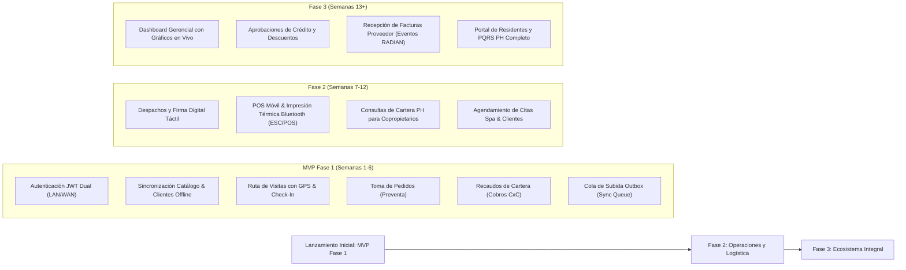
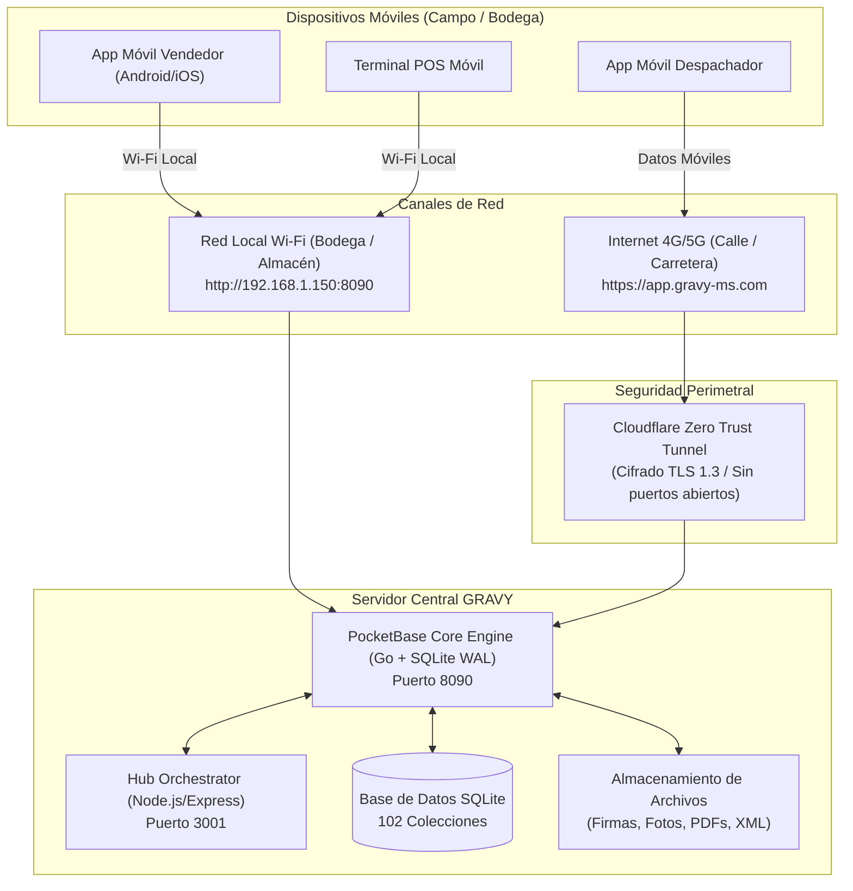
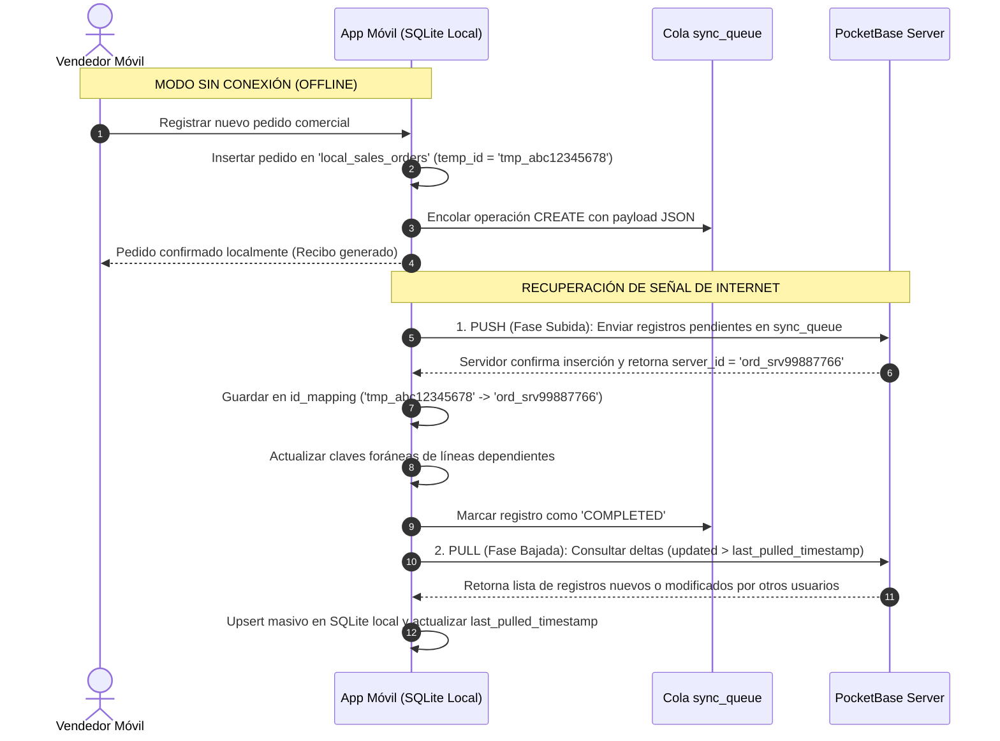

# 📱 MANUAL MAESTRO DE ARQUITECTURA, LÓGICA DE NEGOCIO Y BASE DE DATOS PARA DESARROLLO MÓVIL — ERP GRAVY v2.0
> **Documento Base Oficial de Ingeniería de Software para Equipos Móviles (Flutter / React Native / Kotlin / Swift)**  
> **Sistema ERP:** GRAVY v2.0 | **Backend:** PocketBase v0.22+ (SQLite WAL Mode) + Hub Orchestrator (Node.js/Express)  
> **Ámbito de Aplicación:** Operaciones Móviles en Ruta, Punto de Venta (POS), Logística/Despachos, Cobranza de Cartera, Propiedad Horizontal, Inmobiliaria y Servicios Especializados bajo Normativa Tributaria y Contable de Colombia (DIAN / NIIF / Ley 675).

---

## 👥 PRESENTACIÓN DEL EQUIPO MULTIDISCIPLINARIO AL LÍDER DEL PROYECTO

Estimado Líder de Proyecto:

Como equipo multidisciplinario de ingeniería y normativa, hemos completado una auditoría y análisis exhaustivo de extremo a extremo de todo el código fuente del **ERP GRAVY** (frontend SPA TypeScript modular, backend PocketBase v0.22+, microservicios del Hub Orchestrator, hooks Goja en `pb_hooks/`, y las 102 colecciones relacionales).

Este documento constituye el **Manual Maestro y Archivo Base Unificado** que entregamos a usted para que cualquier equipo de desarrollo externo o interno pueda construir, integrar y desplegar la aplicación móvil corporativa con absoluta autonomía, coherencia arquitectónica, rigor tributario colombiano e integridad de datos.

A continuación, cada uno de nosotros expone su visión, directrices técnicas, modelos y reglas de validación obligatorias.

---

### 📑 TABLA DE CONTENIDO MAESTRO

1. **[VISIÓN ESTRATÉGICA Y CASOS DE USO MÓVIL (Product Owner & Business Analyst)](#1-visión-estratégica-y-casos-de-uso-móvil-product-owner--business-analyst)**
   - Segmentación de Perfiles y Personas Usuarias
   - Matriz de Alcance: MVP Fase 1 vs. Fases Posteriores
   - Mapeo de Flujos Transaccionales de Negocio
2. **[MARCO NORMATIVO Y CONTABLE COLOMBIANO OBLIGATORIO (Equipo Contable y Fiscal)](#2-marco-normativo-y-contable-colombiano-obligatorio-equipo-contable-y-fiscal)**
   - Algoritmo de Dígito de Verificación DIAN (Módulo 11)
   - Estructura PUC (Plan Único de Cuentas) y Partida Doble Inviolable
   - Impuestos y Retenciones en Colombia (IVA, INC, ReteFuente, ReteIVA, ReteICA)
   - Facturación Electrónica DIAN y Algoritmo de Generación CUFE / QR
   - Documento Soporte Electrónico para No Obligados a Facturar (CUDS)
   - Título Valor y Eventos Electrónicos RADIAN (030, 031, 032, 033, 034)
   - Nómina Electrónica: Devengados, Deducciones, CUNE y Provisiones Sociales
   - Régimen de Propiedad Horizontal (Ley 675 de 2001) e Imputación de Pagos
3. **[ARQUITECTURA DE SOFTWARE, CONECTIVIDAD Y OFFLINE-FIRST (Arquitecto Senior)](#3-arquitectura-de-software-conectividad-y-offline-first-arquitecto-senior)**
   - Topología Cliente-Servidor Híbrida (LAN directa vs. Cloudflare Tunnel Zero Trust)
   - Ciclo de Vida de Autenticación, JWT y Almacenamiento Seguro
   - Arquitectura Offline-First con Outbox Pattern (`sync_queue`)
   - Protocolo de Sincronización en Dos Fases (Pull Delta + Push FIFO)
   - Resolución Determinista de Conflictos (LWW y Vector Clocks)
   - Streaming Reactivo vía Server-Sent Events (SSE `/api/realtime`)
4. **[CATÁLOGO TÉCNICO DE APIS, ENDPOINTS Y HOOKS (Desarrollador Full Stack)](#4-catálogo-técnico-de-apis-endpoints-y-hooks-desarrollador-full-stack)**
   - CRUD Universal PocketBase y Filtrado Avanzado
   - Transacciones Atómicas por Lote (`POST /api/batch`)
   - Catálogo de Endpoints Especializados del Ecosistema (`pb_hooks/` y `hub/`)
   - Payloads JSON Exactos (Request/Response) por Caso de Uso
   - Manejo de Archivos Binarios, Fotos y Firmas Táctiles (Multipart)
5. **[DICCIONARIO COMPLETO Y MODELO RELACIONAL DE DATOS (102 COLECCIONES)](#5-diccionario-completo-y-modelo-relacional-de-datos-102-colecciones)**
   - Módulo 1: Seguridad, Usuarios y Licenciamiento
   - Módulo 2: Terceros, Contactos y Rutas Comerciales
   - Módulo 3: Catálogo de Productos e Inventarios Multibodega
   - Módulo 4: Ventas, Facturación, Preventa y POS
   - Módulo 5: Compras, Órdenes y Cuentas por Pagar (CxP)
   - Módulo 6: Contabilidad General, PUC y Asientos
   - Módulo 7: Facturación Electrónica, Resoluciones y DIAN
   - Módulo 8: Tesorería, Bancos, Recaudos y Cartera (CxC)
   - Módulo 9: Nómina Electrónica y Recursos Humanos
   - Módulo 10: Activos Fijos y Normas NIIF
   - Módulo 11: Comercio Exterior e Importaciones (D.O.)
   - Módulo 12: Logística, Flota y Despachos
   - Módulo 13: Vertical Propiedad Horizontal (PH)
   - Módulo 14: Vertical Inmobiliaria
   - Módulo 15: Vertical Spa, Belleza y Citas
6. **[GUÍA DE DISEÑO ERGONÓMICO Y EXPERIENCIA MÓVIL (Diseñador UX/UI Senior)](#6-guía-de-diseño-ergonómico-y-experiencia-móvil-diseñador-uxui-senior)**
   - Ergonomía para Operación en Calle ("The Thumb Zone")
   - Accesibilidad y Contraste WCAG AAA para Luz Solar Directa
   - Semáforo Visual del Estado de Sincronización
   - Flujo de Captura Háptica y Auditiva de Códigos de Barras
   - Canvas de Firma Táctil Vectorial
7. **[INFRAESTRUCTURA DE DESPLIEGUE Y DEVOPS (Ingeniero DevOps)](#7-infraestructura-de-despliegue-y-devops-ingeniero-devops)**
   - Túneles Cloudflare sin Apertura de Puertos
   - Tareas en Segundo Plano (WorkManager Android / BGTasks iOS)
   - Manejo de Redes Móviles Degradadas (Jitter y Reintentos)
   - Pipeline de Compilación y Distribución Continua
8. **[ESTRATEGIA Y MATRIZ DE CALIDAD (QA Engineer / Tester)](#8-estrategia-y-matriz-de-calidad-qa-engineer--tester)**
   - Matriz de Pruebas E2E y Casos de Borde
   - Pruebas de Integridad Matemática y Doble Partida
   - Pruebas de Resiliencia ante Desconexión Forzada (Chaos Testing)
   - Checklist de Certificación para el Equipo Móvil

---

## 1. VISIÓN ESTRATÉGICA Y CASOS DE USO MÓVIL (Product Owner & Business Analyst)

### 1.1. Personas Usuarias y Perfiles de la App Móvil

| Perfil Móvil | Caso de Uso Principal | Módulos PocketBase Involucrados | Requisito Offline |
| :--- | :--- | :--- | :---: |
| **Vendedor en Ruta / Preventista** | Visitas geolocalizadas, toma de pedidos en catálogo, consulta de cupo/cartera de clientes, recaudos inmediatos. | `vendor_visits`, `sales_orders`, `sales_order_lines`, `third_parties`, `products`, `inventory_stock`, `payments`. | **Crítico (100% Offline-First)** |
| **Transportista / Despachador** | Entrega de mercancía con remisión digital, captura de firma táctil del receptor, fotos de evidencia, reporte de novedades/devoluciones. | `logistica_deliveries`, `logistica_delivery_lines`, `logistica_vehicles`, `invoices`, `merchandise_returns`. | **Crítico (Offline-First)** |
| **Cobrador de Cartera / Tesorería** | Gestión de agenda de cobros, recaudos en efectivo/transferencia, generación de recibo de caja digital y notificación inmediata por WhatsApp. | `agenda_vencimientos`, `payments`, `third_parties`, `bank_accounts`, `invoices`. | **Alto** |
| **Cajero POS Móvil** | Venta directa de mostrador en ferias comerciales, pop-up stores o bodegas sin cables. Apertura y cierre de turnos POS, impresión térmica Bluetooth. | `pos_registers`, `pos_shifts`, `invoices`, `invoice_lines`, `payments`, `products`. | **Medio / Alta disponibilidad** |
| **Gerente / Auditor Financiero** | Tablero de mando ejecutivo con KPIs financieros en vivo, aprobación de cotizaciones especiales o descuentos fuera de límite, consulta de saldos bancarios. | `/api/gravy/dashboard-summary`, `/api/gravy/report-*`, `invoices`, `bank_accounts`, `audit_log`. | **Bajo (Requiere conexión en línea)** |
| **Copropietario PH (Vertical)** | Consulta de estado de cuenta de administración, descarga de recibos PDF, reserva de zonas comunes (salón social, BBQ), radicación de PQRS. | `ph_invoices`, `ph_reservations`, `ph_pqrs`, `ph_properties`, `ph_common_areas`. | **Bajo (Modo en línea)** |
| **Especialista Spa / Estética** | Consulta de turnos de atención asignados, registro de insumos consumidos por sesión, visualización de comisiones acumuladas. | `appointments`, `spa_clients`, `commission_rules`, `products`. | **Medio** |

---

### 1.2. Matriz de Alcance: MVP Fase 1 vs. Fases Posteriores



---

### 1.3. Mapeo de Flujos Transaccionales de Negocio (Business Logic)

#### Flujo 1: Ciclo Comercial B2B (Preventa -> Pedido -> Remisión -> Facturación DIAN)
1. El vendedor inicia su jornada activando el servicio de ubicación en segundo plano (`seller_live_locations`).
2. Al llegar a las instalaciones del cliente, ejecuta `POST /api/collections/vendor_visits/records` con coordenadas geográficas del check-in (`geo_lat`, `geo_lng`).
3. La app valida localmente el cupo de crédito del cliente (`third_parties.credit_limit`) frente a la cartera vencida en `agenda_vencimientos`:
   $$\text{Cupo Disponible} = \text{credit\_limit} - \sum \text{saldo\_pendiente}$$
4. El vendedor arma el carrito de compras verificando el stock local (`inventory_stock` por bodega asignada al usuario).
5. Se aplica la lista de precios asignada al cliente (`listas_precios`) con cálculo automático de IVA y descuentos.
6. Se guarda el pedido en `sales_orders` (cabecera) y `sales_order_lines` (detalle).
7. Al recuperar conectividad, la cola de sincronización despacha el pedido.
8. En el servidor, el hook de PocketBase `sales_workflow_orchestrator.pb.js` evalúa la orden:
   - Si se autoriza despacho, genera la remisión en `logistica_deliveries`.
   - Si se asienta como factura (`invoices` con `status = 'posted'`), automáticamente:
     * Disminuye las existencias en `inventory_stock` mediante `inventory_movements` (tipo SALIDA).
     * Si es a crédito (`payment_form = 'credito'`), genera la cuenta por cobrar en `agenda_vencimientos`.
     * Despacha la solicitud de validación a la DIAN vía API Matías para emisión de CUFE.

#### Flujo 2: Cobranza y Recaudo en Ruta (CxC -> Caja/Bancos)
1. El cobrador consulta las facturas pendientes de cobro filtradas por tercero (`agenda_vencimientos` con `status = 'PENDIENTE'`).
2. Recibe el pago (Efectivo, Transferencia, Cheque).
3. La app genera un registro en `payments`:
   - `invoice_id`: ID de la factura impactada.
   - `amount`: Valor recaudado.
   - `payment_method`: 'EFECTIVO' | 'TRANSFERENCIA' | 'CHEQUE'.
   - `bank_account_id`: Cuenta de caja del vendedor o banco recaudador.
4. Si la app está offline, guarda en `sync_queue`.
5. Al sincronizar con el backend, el sistema descuenta el saldo de `agenda_vencimientos`. Si el saldo llega a 0, actualiza `status = 'PAGADO'` y dispara el comprobante contable de ingreso en `transactions` y `tx_lines`.

---

## 2. MARCO NORMATIVO Y CONTABLE COLOMBIANO OBLIGATORIO (Equipo Contable y Fiscal)

> [!IMPORTANT]
> Todo desarrollador móvil debe tener presente que **GRAVY no es un simple gestor de notas o inventario; es un ERP financiero oficial para la República de Colombia**. Cada transacción que se capture en la app móvil debe respetar las normas de la DIAN, las Normas Internacionales de Información Financiera (NIIF para Pymes) y el Código de Comercio.

### 2.1. Algoritmo del Dígito de Verificación DIAN (Módulo 11)
Para validar que un NIT ingresado en campo por el vendedor sea matemáticamente legítimo antes de crear un tercero, se aplica el algoritmo del Módulo 11 con los 15 números primos oficiales:
$$\text{Pesos Primos DIAN} = [3, 7, 13, 17, 19, 23, 29, 37, 41, 43, 47, 53, 59, 67, 71]$$

```typescript
// Implementación oficial del algoritmo DIAN en TypeScript / Dart
export function calcularDigitoVerificacion(nit: string): number {
  const nitLimpio = nit.replace(/\D/g, '');
  if (!nitLimpio) return 0;
  
  const pesos = [3, 7, 13, 17, 19, 23, 29, 37, 41, 43, 47, 53, 59, 67, 71];
  let suma = 0;
  const longitud = nitLimpio.length;

  for (let i = 0; i < longitud; i++) {
    const digito = parseInt(nitLimpio.charAt(longitud - 1 - i), 10);
    suma += digito * pesos[i];
  }

  const residuo = suma % 11;
  if (residuo === 0 || residuo === 1) {
    return residuo;
  }
  return 11 - residuo;
}
```

---

### 2.2. Estructura del Plan Único de Cuentas (PUC) y Partida Doble
En GRAVY, el catálogo de cuentas contables reside en la colección `accounts`.
- **Estructura Jerárquica:**
  - `1`: Activo (Naturaleza Débito)
  - `2`: Pasivo (Naturaleza Crédito)
  - `3`: Patrimonio (Naturaleza Crédito)
  - `4`: Ingresos (Naturaleza Crédito)
  - `5`: Gastos (Naturaleza Débito)
  - `6`: Costos de Ventas (Naturaleza Débito)
  - `7`: Costos de Producción (Naturaleza Débito)

- **Principio Inviolable de Partida Doble:**  
  Cualquier transacción registrada en `transactions` con sus renglones en `tx_lines` debe cumplir con:
  $$\sum \text{debit} - \sum \text{credit} = 0.00$$
  La tolerancia de descuadre es **cero absoluto**. Los valores monetarios deben redondearse estrictamente a 2 decimales para evitar desfasajes por precisión en punto flotante.

---

### 2.3. Esquema de Impuestos y Retenciones en Colombia

| Concepto Fiscal | Tarifa Estándar | Base Mínima UVT (Vigente) | Naturaleza Contable en Ventas | Cuenta PUC Sugerida |
| :--- | :---: | :---: | :--- | :---: |
| **IVA General** | 19.0% | $0 (Desde el primer peso) | Crédito (Pasivo por pagar a DIAN) | `240801` |
| **IVA Diferencial** | 5.0% | $0 (Bienes canasta básica art. 468-1 ET) | Crédito | `240802` |
| **Impoconsumo (INC)** | 8.0% | $0 (Restaurantes, bares y servicios) | Crédito (No genera IVA descontable) | `240805` / `2495` |
| **ReteFuente (Compras)** | 2.5% / 3.5% | 27 UVT (Declarante 2.5%, No declarante 3.5%) | Débito (Anticipo de impuesto / Activo) | `135515` |
| **ReteFuente (Servicios)** | 4.0% / 6.0% | 4 UVT | Débito (Anticipo) | `135515` |
| **ReteIVA** | 15% del IVA | Aplicable sobre el valor del IVA facturado | Débito (Anticipo) | `135517` |
| **ReteICA** | 2‰ a 11.04‰ | Según Acuerdo Municipal y Código CIIU | Débito (Anticipo municipal) | `135518` |

**Fórmulas Matemáticas de Liquidación:**
$$\text{Base Gravable} = \sum (\text{Cantidad} \times \text{Precio Unitario}) - \text{Descuentos}$$
$$\text{Valor IVA} = \text{Base Gravable} \times \frac{\text{Tarifa IVA}}{100}$$
$$\text{Valor ReteFuente} = \text{Base Gravable} \times \frac{\text{Tarifa ReteFuente}}{100} \quad (\text{si Base} \ge \text{Base Mínima UVT})$$
$$\text{Valor ReteIVA} = \text{Valor IVA} \times 0.15$$
$$\text{Total a Pagar} = \text{Base Gravable} + \text{IVA} + \text{INC} - \text{ReteFuente} - \text{ReteIVA} - \text{ReteICA}$$

---

### 2.4. Facturación Electrónica DIAN y Algoritmo CUFE
El backend de GRAVY interactúa con la DIAN a través del microservicio Matías API (`pb_hooks/dian.pb.js` y `hub/orchestrator.js`).
El **CUFE** (Código Único de Facturación Electrónica) es un hash SHA-384 calculado sobre una cadena de texto estricta según el Anexo Técnico 1.9 de la DIAN:

$$\text{CUFE} = \text{SHA-384}(\text{NumFac} + \text{FecFac} + \text{HorFac} + \text{ValFac} + \text{CodImp1} + \text{ValImp1} + \dots + \text{NitOFE} + \text{NumAdq} + \text{ClaveTecnica} + \text{TipoAmbiente})$$

- **Código QR Obligatorio:** Debe incluir la URL oficial de consulta DIAN conteniendo el CUFE, NIT del emisor, NIT del adquiriente, fecha y valor total.
- **Validación Previa:** Las facturas emitidas en la app móvil se almacenan con estado `pending` o `posted`. El proceso de firmado electrónico, generación del XML UBL 2.1 y timbrado CUFE se delega al backend al sincronizar mediante el endpoint:
  `POST /api/dian/emit` con `{ "invoice_id": "<id_factura>" }`.

---

### 2.5. Título Valor y Eventos Electrónicos RADIAN
Para facturas de venta a crédito que actúen como título valor, la app móvil permite consultar o reportar eventos comerciales de recepción de mercancía:
- **Evento 030:** Acuse de recibo de la Factura Electrónica de Venta.
- **Evento 031:** Recibo del bien o de la prestación del servicio (firmado por el bodeguero en la app móvil).
- **Evento 032:** Aceptación expresa.
- **Evento 033:** Aceptación tácita (transcurridas 72 horas hábiles desde el evento 031).
- **Evento 034:** Reclamo de la factura (novedad o rechazo de mercancía).

---

### 2.6. Nómina Electrónica: Devengados, Deducciones y CUNE
La colección `payroll_documents` y el endpoint `/api/dian/nomina/emit` manejan la nómina electrónica en Colombia:
- **Seguridad Social del Empleado (Deducciones obligatorias):**
  - Salud: 4% sobre el IBC (Ingreso Base de Cotización).
  - Pensión: 4% sobre el IBC.
  - Fondo de Solidaridad Pensional (FSP): 1% adicional si el salario $\ge 4 \text{ SMMLV}$.
- **Auxilio de Transporte:** Obligatorio para trabajadores con salario hasta $2 \text{ SMMLV}$ (No constituye salario para liquidación de aportes parafiscales pero sí para prestaciones sociales).
- **Aportes Patronales y Provisiones:**
  - Cesantías: 8.33%
  - Intereses sobre Cesantías: 1.0% mensual (12% anual)
  - Prima de Servicios: 8.33%
  - Vacaciones: 4.17%

---

### 2.7. Ley 675 de 2001 (Propiedad Horizontal)
Para la vertical de copropiedades y conjuntos residenciales (`ph_properties`, `ph_invoices`):
1. **Coeficiente de Copropiedad:** Cada apartamento, local o parqueadero tiene un coeficiente porcentual a 4 o 6 decimales. La suma total de coeficientes de todas las unidades debe ser exactamente **100.0000%**.
2. **Fondo de Imprevistos:** Mínimo el 1% del presupuesto total de gastos anuales de la copropiedad (inembargable).
3. **Cálculo de Intereses de Mora:**  
   Según el artículo 30 de la Ley 675, los propietarios en mora pagarán intereses a la **tasa de usura** máxima certificada por la Superintendencia Financiera de Colombia (calculada 1.5 veces el interés bancario corriente).
4. **Orden de Imputación de Pagos (Código Civil):**  
   Cuando un propietario abona a una deuda acumulada, el recaudo se distribuye en estricto orden:
   $$\text{1. Costas y Gastos de Cobranza} \longrightarrow \text{2. Intereses Moratorios} \longrightarrow \text{3. Cuotas de Administración más antiguas (Capital)}$$

---

## 3. ARQUITECTURA DE SOFTWARE, CONECTIVIDAD Y OFFLINE-FIRST (Arquitecto Senior)

### 3.1. Topología Híbrida de Conexión



**Regla de Selección Dinámica de URL en la App Móvil:**
La app debe implementar una clase singleton `NetworkManager` que detecta la accesibilidad de la LAN mediante un ping liviano a `GET /api/health` con timeout de 800ms. Si responde, conmuta a URL LAN para latencia ultra baja (<5ms); si no, redirige transparentemente al dominio Cloudflare Tunnel HTTPS.

---

### 3.2. Ciclo de Vida de Autenticación JWT y Almacenamiento Seguro
1. **Inicio de Sesión:**
   `POST /api/collections/users/auth-with-password`
   - Payload: `{ "identity": "vendedor@empresa.com", "password": "..." }`
   - Retorno: `{ "token": "...", "record": { "id": "...", "role": ["vendedor"], ... } }`
2. **Almacenamiento en el Dispositivo:**
   - **Flutter:** Utilizar `flutter_secure_storage` (cifrado con Keystore en Android y Keychain en iOS).
   - **React Native:** Utilizar `expo-secure-store` o `react-native-keychain`.
   - ⚠️ **PROHIBICIÓN ESTRICTA:** No almacenar tokens JWT en `AsyncStorage`, `SharedPreferences` plano ni `localStorage`.
3. **Renovación Transparente (Silent Refresh):**
   Al iniciar la app o cada 24 horas con conectividad:
   `POST /api/collections/users/auth-refresh` con header `Authorization: Bearer <token>`.
4. **Header Obligatorio:** En toda petición subsecuente:
   `Authorization: Bearer <token>`

---

### 3.3. Arquitectura Offline-First con Outbox Pattern

Para garantizar que un preventista en una bodega subterránea o en zona rural colombiana pueda operar al 100% sin señal celular, la arquitectura móvil se fundamenta en el patrón **Outbox / Sync Queue**.

#### Estructura de la Base de Datos Local en el Dispositivo Móvil (SQLite):
```sql
-- Tabla de Cola de Mutaciones Locales (Outbox Pattern)
CREATE TABLE sync_queue (
    id INTEGER PRIMARY KEY AUTOINCREMENT,
    queue_uuid TEXT UNIQUE NOT NULL,       -- UUID v4 generado en el móvil
    collection_name TEXT NOT NULL,          -- ej: 'sales_orders', 'vendor_visits'
    operation TEXT NOT NULL,                -- 'CREATE', 'UPDATE', 'DELETE'
    temp_id TEXT NOT NULL,                  -- ID temporal de 15 caracteres
    payload_json TEXT NOT NULL,             -- Payload serializado
    dependencies_json TEXT,                 -- IDs temporales de los que depende
    created_at TEXT NOT NULL,               -- ISO 8601 UTC
    status TEXT DEFAULT 'PENDING',          -- 'PENDING', 'PROCESSING', 'FAILED', 'COMPLETED'
    retry_count INTEGER DEFAULT 0,
    last_error TEXT
);

-- Tabla de Mapeo de Identificadores (Temporal -> Definitivo)
CREATE TABLE id_mapping (
    temp_id TEXT PRIMARY KEY,
    server_id TEXT NOT NULL,
    collection_name TEXT NOT NULL,
    mapped_at TEXT NOT NULL
);

-- Metadatos de Sincronización Delta
CREATE TABLE sync_metadata (
    collection_name TEXT PRIMARY KEY,
    last_pulled_timestamp TEXT NOT NULL,
    total_records INTEGER DEFAULT 0
);
```

---

### 3.4. Protocolo de Sincronización en Dos Fases



---

### 3.5. Resolución Determinista de Conflictos

1. **Estrategia LWW (Last-Write-Wins con Timestamp del Servidor):**  
   Si dos usuarios modifican el mismo registro (por ejemplo, el cupo de crédito de un cliente), la última marca temporal validada por el reloj del servidor SQLite prevalece.
2. **Inventario y Existencias:**  
   El stock **NUNCA se sobreescribe con valor absoluto** desde el móvil. La app registra únicamente movimientos relativos:
   `qty_change = -5` (Salida). El servidor ejecuta la operación atómica:
   ```sql
   UPDATE inventory_stock SET stock = stock - 5 WHERE id = '...';
   ```
   Esto previene condiciones de carrera cuando múltiples vendedores toman pedidos simultáneamente.

---

### 3.6. Streaming Reactivo vía Server-Sent Events (SSE)
Para dispositivos conectados, PocketBase provee un bus en tiempo real sin requerir polling periódico:
```javascript
// Conexión reactiva en la app móvil
pb.collection('sales_orders').subscribe('*', function (e) {
    console.log("Acción en tiempo real:", e.action); // 'create', 'update', 'delete'
    console.log("Registro actualizado:", e.record);
    // Actualizar base de datos local y emitir evento a la UI reactiva (Bloc / Provider)
});
```

---

## 4. CATÁLOGO TÉCNICO DE APIS, ENDPOINTS Y HOOKS (Desarrollador Full Stack)

### 4.1. Endpoints REST Universales PocketBase

| Acción | Método HTTP | Ruta de Endpoint | Parámetros Clave |
| :--- | :---: | :--- | :--- |
| **Listar con Filtro** | `GET` | `/api/collections/{collection}/records` | `page`, `perPage`, `filter`, `sort`, `expand` |
| **Obtener Registro** | `GET` | `/api/collections/{collection}/records/{id}` | `expand` (relaciones anidadas) |
| **Crear Registro** | `POST` | `/api/collections/{collection}/records` | Headers: `Content-Type: application/json` |
| **Actualizar Parcial** | `PATCH` | `/api/collections/{collection}/records/{id}` | Campos modificados |
| **Eliminar Registro** | `DELETE` | `/api/collections/{collection}/records/{id}` | - |
| **Transacción en Lote** | `POST` | `/api/batch` | Array de sub-peticiones atómicas |

---

### 4.2. Endpoints Especializados del Ecosistema GRAVY (`pb_hooks/` y `hub/`)

A continuación se documentan los endpoints server-side desarrollados exclusivamente para la lógica contable y de orquestación de GRAVY:

#### A) KPIs Gerenciales Consolidados
- **Ruta:** `GET /api/gravy/dashboard-summary`
- **Headers:** `Authorization: Bearer <token>`
- **Query Params:** `branch_id` (opcional), `cost_center_id` (opcional)
- **Respuesta JSON:**
  ```json
  {
    "core": {
      "total_customers": 412,
      "total_products": 1250,
      "pending_orders": 8,
      "low_stock_alerts": 14
    },
    "contabilidad": {
      "activos_total": 450230000.50,
      "pasivos_total": 120450000.00,
      "patrimonio_total": 329780000.50,
      "ingresos_mes": 89400000.00,
      "gastos_mes": 34100000.00,
      "utilidad_neta": 55300000.00
    }
  }
  ```

#### B) Agenda y Flujo de Caja en Tiempo Real
- **Ruta:** `GET /api/gravy/agenda/real-cashflow`
- **Headers:** `Authorization: Bearer <token>`
- **Descripción:** Consolida vencimientos de cuentas por cobrar (CxC) y cuentas por pagar (CxP) por rango de fechas para estimación de liquidez.

#### C) Reportes Contables y de Cartera Optimizados
- `GET /api/gravy/report-balances`: Balance de prueba a 6 y 8 dígitos.
- `GET /api/gravy/report-portfolio-aging`: Cartera por edades (0-30, 31-60, 61-90, >90 días).
- `GET /api/gravy/report-sales-by-seller`: Consolidado de ventas por asesor comercial.
- `GET /api/gravy/report-ph-cartera`: Cartera de cuotas de administración por unidad residencial.

#### D) Facturación Electrónica y DIAN
- `POST /api/dian/emit`: Timbrado y transmisión de factura a DIAN vía Matías API.
  - Body: `{ "invoice_id": "fac_1234567890abc" }`
- `POST /api/dian/check-status`: Consulta el estado de procesamiento del documento en la DIAN.
- `POST /api/dian/nomina/emit`: Emisión de nómina electrónica a la DIAN.

#### E) Facturación Masiva de Propiedad Horizontal (PH)
- `POST /api/ph/generate-period`: Genera automáticamente las cuotas de administración del mes según los coeficientes de cada unidad residencial.
- `POST /api/ph/send-bulk-emails`: Envío masivo de estados de cuenta en PDF por correo electrónico.

#### F) Integración de WhatsApp y Notificaciones
- `GET /api/whatsapp/status`: Verifica si la sesión de WhatsApp Web está autenticada.
- `POST /api/whatsapp/send-pdf`: Envío de facturas, pedidos o recibos de caja en PDF directamente al chat del cliente.

---

### 4.3. Payloads JSON Exactos de Transacciones Críticas

#### Payload 1: Creación de Pedido Comercial Móvil (Sales Order)
```json
// POST /api/collections/sales_orders/records
{
  "number": "PED-MOV-1002",
  "customer_id": "c1a2b3c4d5e6f7g",
  "seller_id": "u9z8y7x6w5v4u3t",
  "warehouse_id": "w1a2b3c4d5e6f7g",
  "branch_id": "b1a2b3c4d5e6f7g",
  "date": "2026-11-23",
  "due_date": "2026-12-08",
  "payment_form": "credito",
  "payment_method": "TRANSFERENCIA",
  "subtotal": 200000.00,
  "discount_amount": 10000.00,
  "iva_total": 36100.00,
  "total": 226100.00,
  "status": "pending",
  "fulfillment_status": "SIN_GESTION",
  "notes": "Entregar en la mañana. Contactar a recepción."
}
```

#### Payload 2: Línea de Pedido Comercial (Sales Order Line)
```json
// POST /api/collections/sales_order_lines/records
{
  "sales_order_id": "ord_srv99887766",
  "product_id": "p1a2b3c4d5e6f7g",
  "line_order": 1,
  "description": "Aceite de Oliva Extra Virgen 500ml",
  "qty": 10,
  "unit_price": 20000.00,
  "discount_pct": 5.0,
  "discount_amount": 10000.00,
  "iva_rate": 19.0,
  "iva_amount": 36100.00,
  "subtotal": 190000.00,
  "total": 226100.00
}
```

#### Payload 3: Recaudo de Cartera (Payment / Recibo de Caja)
```json
// POST /api/collections/payments/records
{
  "invoice_id": "fac_1234567890abc",
  "amount": 226100.00,
  "payment_method": "EFECTIVO",
  "bank_account_id": "caja_menor_vendedor_01",
  "date": "2026-11-23 15:30:00",
  "notes": "Pago total de factura en visita presencial"
}
```

---

## 5. DICCIONARIO COMPLETO Y MODELO RELACIONAL DE DATOS (102 COLECCIONES)

A continuación se detalla la matriz relacional de las colecciones que soportan el backend PocketBase de GRAVY, con especial énfasis en las entidades con las cuales interactúa la aplicación móvil.

### 5.1. Módulo 1: Seguridad, Usuarios y Licenciamiento
- **`users` (Auth):** Usuarios del sistema (`id`, `email`, `role`: [`superadmin`, `admin`, `contador`, `auxiliar`, `auditor`, `propietario`, `viewer`, `vendedor`, `cajero`], `full_name`, `active`, `owner_id` -> `third_parties`, `default_branch_id` -> `branches`, `allowed_branches`, `default_warehouse_id` -> `warehouses`, `allowed_warehouses`, `active_session_id`).
- **`licenses`:** Control de activación de módulos por empresa (`module_key`: [`core`, `contabilidad`, `comercial`, `nomina`, `copropiedades`, `inmobiliarias`, `logistica`, `inventarios`, `tesoreria`, `spa`, `crm`, `niif`], `enabled`, `expires_at`, `plan`).
- **`branches`:** Sucursales o sedes de la empresa (`code`, `name`, `active`).
- **`cost_centers`:** Centros de costo contables y operativos (`code`, `name`, `parent_id` -> `cost_centers`, `active`).
- **`audit_log`:** Trazabilidad inmutable de acciones de usuario (`username`, `action`, `entity`, `entity_id`, `details`, `ip`, `event_at`).

### 5.2. Módulo 2: Terceros, Contactos y Rutas Comerciales
- **`third_parties`:** Clientes, proveedores, empleados y copropietarios (`type`: [`CLIENTE`, `PROVEEDOR`, `EMPLEADO`, `PROPIETARIO`], `doc_type`: [`CC`, `NIT`, `CE`, `PP`, `TI`], `doc_number`, `dv`, `name`, `first_name`, `last_name`, `commercial_name`, `phone`, `email`, `address`, `city`, `department`, `tax_regime`, `credit_limit`, `payment_days`, `active`).
- **`vendor_visits`:** Planificación y ejecución de visitas del vendedor (`seller_id` -> `users`, `client_id` -> `third_parties`, `visit_date`, `status`: [`PENDIENTE`, `EN_PROCESO`, `EFECTIVA`, `NO_EFECTIVA`], `objective`, `checkin_time`, `checkout_time`, `geo_lat`, `geo_lng`, `sales_order_id`, `notes`).
- **`seller_live_locations`:** Posición satelital instantánea del asesor en ruta (`seller_id` -> `users`, `seller_name`, `lat`, `lng`, `accuracy`, `speed`, `heading`, `battery_level`, `is_charging`, `status`, `current_visit_id`, `last_ping`).
- **`seller_tracking_logs`:** Histórico inmutable de telemetría de ruta para liquidación de viáticos y auditoría de desplazamientos.
- **`crm_deals`:** Oportunidades y pipeline comercial (`title`, `customer_id`, `stage`, `expected_amount`, `closing_date`).
- **`crm_interactions`:** Bitácora de llamadas, mensajes de WhatsApp y reuniones.

### 5.3. Módulo 3: Catálogo de Productos e Inventarios Multibodega
- **`products`:** Ficha de producto y servicio (`code`, `barcode`, `name`, `description`, `category`, `unit_measure`, `base_price`, `cost_price`, `iva_rate`, `inc_rate`, `is_service`, `track_inventory`, `image`, `active`).
- **`listas_precios`:** Tarifarios diferenciados (`code`, `name`, `currency`, `active`).
- **`precios_producto`:** Precio específico por lista y producto (`price_list_id` -> `listas_precios`, `product_id` -> `products`, `price`).
- **`warehouses`:** Bodegas físicas y móviles (ej. el camión de reparto actúa como bodega) (`code`, `name`, `branch_id`, `is_mobile`, `active`).
- **`inventory_stock`:** Existencias en tiempo real (`warehouse_id` -> `warehouses`, `product_id` -> `products`, `stock`, `reserved_stock`, `reorder_point`).
- **`inventory_movements`:** Cabecera de movimientos de kárdex (`movement_type`: [`ENTRADA`, `SALIDA`, `TRASLADO`, `AJUSTE`], `source_warehouse_id`, `target_warehouse_id`, `date`, `concept_id`).
- **`inventory_movement_lines`:** Detalle de kárdex (`movement_id`, `product_id`, `qty`, `unit_cost`, `lot_id`).
- **`inventory_lots`:** Gestión de lotes y fechas de vencimiento para perecederos o farmacéuticos.

### 5.4. Módulo 4: Ventas, Facturación y Punto de Venta (POS)
- **`sales_orders`:** Cabecera de pedidos comerciales (`number`, `customer_id`, `seller_id`, `warehouse_id`, `branch_id`, `date`, `due_date`, `subtotal`, `iva_total`, `total`, `status`, `fulfillment_status`).
- **`sales_order_lines`:** Renglones de pedido (`sales_order_id`, `product_id`, `qty`, `unit_price`, `discount_amount`, `iva_amount`, `total`).
- **`invoices`:** Facturas de venta y comprobantes POS (`number`, `resolution_id`, `customer_id`, `date`, `due_date`, `payment_form`, `payment_method`, `subtotal`, `iva_total`, `payable_total`, `status`: [`draft`, `posted`, `annulled`], `cufe`, `qr_code`).
- **`invoice_lines`:** Detalle de factura (`invoice_id`, `product_id`, `qty`, `unit_price`, `iva_rate`, `total`).
- **`pos_registers`:** Cajas registradoras físicas o terminales móviles autorizadas.
- **`pos_shifts`:** Turnos de caja (`register_id`, `user_id`, `opened_at`, `closed_at`, `opening_balance`, `cash_sales`, `card_sales`, `closing_balance`, `difference`).

### 5.5. Módulo 5: Compras y Proveedores
- **`purchase_orders`:** Órdenes de compra a proveedores nacionales o internacionales.
- **`purchase_invoices`:** Facturas de proveedor y cuentas por pagar causadas.
- **`purchase_invoice_lines`:** Insumos y mercancías ingresadas a bodega.

### 5.6. Módulo 6: Contabilidad General, PUC y Transacciones
- **`accounts`:** Plan Único de Cuentas (`code`, `name`, `level`, `parent_id`, `nature`: [`DEBIT`, `CREDIT`], `is_detail`, `active`).
- **`transactions`:** Asientos y comprobantes contables (`number`, `date`, `tx_type_id`, `concept`, `status`, `book_type`: [`niif`, `local`]).
- **`tx_lines`:** Partida doble por renglón (`transaction_id`, `account_id`, `third_party_id`, `cost_center_id`, `debit`, `credit`, `description`).
- **`exogena_concepts`:** Mapeo de cuentas a formatos DIAN (1001, 1003, etc.).

### 5.7. Módulo 7: Facturación Electrónica y DIAN
- **`dian_resolutions`:** Resoluciones de facturación autorizadas por la DIAN (`prefix`, `resolution_number`, `date_from`, `date_to`, `from_number`, `to_number`, `current_number`, `technical_key`).
- **`electronic_documents`:** Registro de XML UBL 2.1 emitidos y su estado ante el servidor DIAN.
- **`einvoice_docs`:** Buzón de facturas electrónicas de compras recibidas para eventos RADIAN.

### 5.8. Módulo 8: Tesorería, Bancos y Cartera
- **`bank_accounts`:** Cuentas corrientes, de ahorros y cajas menores (`account_number`, `bank_name`, `gl_account_id` -> `accounts`, `current_balance`).
- **`agenda_vencimientos`:** Cartera viva por cobrar y pagar (`type`: [`CXC`, `CXP`], `document_number`, `third_party_id`, `issue_date`, `due_date`, `total_amount`, `paid_amount`, `balance`, `status`).
- **`payments`:** Recaudos y pagos efectuados (`invoice_id`, `amount`, `payment_method`, `bank_account_id`, `date`).

### 5.9. Módulo 9: Recursos Humanos y Nómina Electrónica
- **`payroll_periods`:** Periodos de liquidación quincenal o mensual.
- **`payroll_documents`:** Desprendibles de nómina por empleado con devengados y deducciones.
- **`electronic_payrolls`:** Transmisión del CUNE a la DIAN.

### 5.10. Módulo 10: Activos Fijos y Normas NIIF
- **`niif_assets`:** Registro de activos fijos, vida útil, método de depreciación y valor residual.
- **`niif_asset_events`:** Depreciaciones mensuales y bajas de activos.

### 5.11. Módulo 11: Comercio Exterior e Importaciones (D.O.)
- **`imports`:** Documentos de Operación (D.O.), aranceles, seguros y fletes para costeo de importación.

### 5.12. Módulo 12: Logística, Flota y Despachos
- **`logistica_vehicles`:** Vehículos de reparto (`plate`, `brand`, `driver_id` -> `third_parties`, `capacity_kg`).
- **`logistica_deliveries`:** Manifiestos de entrega en ruta (`delivery_number`, `vehicle_id`, `driver_id`, `status`: [`PLANIFICADO`, `EN_TRANSITO`, `ENTREGADO`, `NOVEDAD`], `signature_file`, `photo_evidence`).
- **`logistica_delivery_lines`:** Facturas y pedidos montados en cada ruta de despacho.

### 5.13. Módulo 13: Vertical Propiedad Horizontal (PH)
- **`ph_properties`:** Unidades residenciales (apartamentos, casas, locales, parqueaderos) con sus coeficientes de copropiedad y propietarios vinculados.
- **`ph_budgets`:** Presupuesto anual de ingresos y gastos aprobado en asamblea.
- **`ph_invoices`:** Cuentas de cobro de administración generadas mensualmente.
- **`ph_reservations`:** Reservas de zonas comunes (salones sociales, canchas, zona BBQ).
- **`ph_pqrs`:** Peticiones, Quejas, Reclamos y Sugerencias de los copropietarios.

### 5.14. Módulo 14: Vertical Inmobiliaria
- **`inmo_properties`:** Inmuebles bajo administración y corretaje.
- **`inmo_contracts`:** Contratos de arrendamiento entre propietario y arrendatario.
- **`inmo_invoices`:** Cánones mensuales de arrendamiento y dispersión de comisiones.

### 5.15. Módulo 15: Vertical Spa, Belleza y Citas
- **`spa_clients`:** Ficha de clientes de estética y servicios.
- **`appointments`:** Citas agendadas por especialista, fecha, hora y servicio contratado.
- **`commission_rules`:** Reglas de comisión porcentual por profesional de belleza.

---

## 6. GUÍA DE DISEÑO ERGONÓMICO Y EXPERIENCIA MÓVIL (Diseñador UX/UI Senior)

### 6.1. Ergonomía para Operación en Calle ("The Thumb Zone")
Los asesores comerciales en ruta y los transportistas sostienen el teléfono con una sola mano mientras sostienen paquetes o interactúan con clientes.
- **Zona Natural del Pulgar (Thumb Zone):** Los botones principales de acción (CTA como "Guardar Pedido", "Cobrar", "Escanear") deben ubicarse estrictamente en el tercio inferior de la pantalla (Bottom App Bar o Floating Action Buttons extendidos).
- **Áreas Táctiles Mínimas:** Los elementos interactivos deben medir como mínimo **$48 \times 48 \text{ dp}$** para evitar pulsaciones erróneas en entornos de movimiento o vibración de vehículos.

---

### 6.2. Accesibilidad y Contraste Solar WCAG AAA
Bajo la luz solar directa en calles de Colombia, las pantallas sufren reflejos y baja legibilidad.
- **Paleta de Colores de Alto Contraste:**
  - Azul Corporativo GRAVY: `#1A4B8C` (Contraste 7.8:1 sobre blanco)
  - Verde de Éxito / Cobro: `#0D7A3E` (Contraste 8.1:1 sobre blanco)
  - Rojo de Alerta / Mora: `#C51919` (Contraste 6.5:1 sobre blanco)
  - Fondo de Aplicación: `#F8FAFC` (Gris frío de baja fatiga visual)
- Tipografía en negrita media (font-weight 600+) para precios, saldos de cartera y cantidades numéricas.

---

### 6.3. Semáforo Visual del Estado de Sincronización
La barra superior (Top Bar) de la app móvil debe incluir un indicador persistente y legible del estado de conexión:
- 🟢 **Verde Sólido ("En línea / Sincronizado"):** Conectado al servidor central, sin mutaciones pendientes en cola.
- 🟡 **Amarillo Pulsante ("Sincronizando"):** Transmitiendo pedidos o cobros de la cola local (`sync_queue`).
- 🔴 **Rojo con Contador ("Modo Desconectado [N]"):** Sin conexión a internet. El número $[N]$ indica la cantidad de pedidos o cobros resguardados localmente en SQLite listos para subirse.

---

### 6.4. Captura Háptica y Auditiva en Escaneo de Códigos
Al escanear códigos de barras de productos (EAN-13, Code-128) con la cámara o con escáner láser Bluetooth integrado:
1. Retroalimentación táctil de vibración corta de 50 milisegundos (`HapticFeedback.lightImpact()`).
2. Sonido acústico positivo de confirmación (`Beep` en frecuencia 1200 Hz).
3. Suma inmediata de +1 unidad en el carrito de compras sin cerrar la cámara (modo de escaneo continuo para inventarios).

---

### 6.5. Canvas Vectorial de Firma Táctil
Para recepciones de despacho (`logistica_deliveries`) y recibos de pago:
- Módulo de firma táctil con suavizado Bézier para trazo fluido.
- Captura de coordenadas del trazo y exportación a PNG con fondo transparente con compresión máxima (tamaño < 40 KB).
- Envío al servidor mediante `multipart/form-data` asociado al campo `signature_file`.

---

## 7. INFRAESTRUCTURA DE DESPLIEGUE Y DEVOPS (Ingeniero DevOps)

### 7.1. Acceso Seguro vía Cloudflare Tunnel Zero Trust
- El backend PocketBase y el Hub Orchestrator operan protegidos tras el demonio `cloudflared`.
- **Ventaja de Seguridad:** La empresa no requiere IP pública fija ni apertura de puertos en el enrutador local (sin riesgos de escaneo de puertos o ataques DDoS).
- **Configuración de Conexión en la App:** El cliente móvil negocia HTTPS con TLS 1.3 con certificados gestionados por Cloudflare.

---

### 7.2. Tareas en Segundo Plano (Background Sync)
- **Android:** Implementar `WorkManager` con política de reintento exponencial (`BackoffPolicy.EXPONENTIAL`) y restricción de red `NetworkType.CONNECTED`.
- **iOS:** Configurar `BGAppRefreshTask` en el archivo `Info.plist` para despertar la app silenciosamente cuando el dispositivo cuente con conexión Wi-Fi o celular óptima.
- **Geocercas (Geofencing):** Al detectar que el vendedor ingresa al perímetro de 100 metros de un cliente programado, la app despierta la notificación de inicio de visita.

---

### 7.3. Manejo de Redes Celulares Inestables (Jitter y Reintentos)
Las redes 3G/4G en trayectos intermunicipales sufren latencias variables y cortes abruptos.
- **Timeout HTTP Ajustado:** Timeout de conexión de 5 segundos y timeout de lectura de 15 segundos.
- **Reintentos con Jitter:**
  $$T_{\text{espera}} = 2^{\text{intento}} \times 1000\text{ ms} + \text{Random}(0, 500\text{ ms})$$
  Esto evita que múltiples dispositivos saturen el servidor al recuperar cobertura simultáneamente tras un túnel o zona oscura.

---

## 8. ESTRATEGIA Y MATRIZ DE CALIDAD (QA Engineer / Tester)

### 8.1. Matriz de Pruebas End-to-End (E2E)

| ID Prueba | Escenario de Prueba | Comportamiento Esperado | Criterio de Aprobación |
| :---: | :--- | :--- | :--- |
| **TC-MOB-01** | Inicio de sesión con credenciales válidas en red LAN. | Respuesta en <200ms, token guardado en Secure Storage, descarga de catálogos iniciales. | Token presente y válido. |
| **TC-MOB-02** | Toma de pedido con 5 productos en Modo Avión (Offline). | Pedido guardado en SQLite local, ID temporal asignado, registro en `sync_queue` con status 'PENDING'. | Carrito vaciado, confirmación en pantalla. |
| **TC-MOB-03** | Reconexión a internet tras tomar 3 pedidos offline. | `SyncWorker` despierta, envía pedidos en orden FIFO, mapea IDs temporales a IDs definitivos de PocketBase. | `sync_queue` queda vacía, pedidos visibles en web. |
| **TC-MOB-04** | Intento de registrar asiento contable descuadrado ($\sum D \ne \sum C$). | El motor de validación local y el servidor rechazan la transacción con HTTP 400. | Error explícito de "Partida doble no balanceada". |
| **TC-MOB-05** | Check-in de visita sin permisos de GPS. | La app solicita el permiso en tiempo de ejecución. Si se deniega, no permite check-in y sugiere activar ubicación. | Bloqueo controlado con mensaje amigable. |
| **TC-MOB-06** | Generación de CUFE con NIT erróneo. | Validación previa de Dígito de Verificación rechaza el documento antes de emitir a DIAN. | Notificación de error al usuario. |
| **TC-MOB-07** | Captura y subida de firma digital en remisión de entrega. | Firma exportada en PNG de <50KB, subida vía Multipart y renderizada en el backend. | Archivo legible en `/api/files/...`. |

---

### 8.2. Chaos Network Testing (Pruebas de Caos de Red)
El equipo de QA debe someter la app móvil a la herramienta de simulación de red con perfiles degradados:
- **Perfil 1 (Edge / 2G Rural):** Ancho de banda 128 kbps, latencia 800ms, 15% packet loss.
- **Perfil 2 (Túnel Ferroviario):** Conexión activa que se corta abruptamente a la mitad de una petición POST `/api/batch`. La cola local debe conservar el estado 'PENDING' y no duplicar transacciones al reconectar (verificación de Idempotencia por UUID).

---

## 9. CONCLUSIÓN Y HOJA DE RUTA PARA EQUIPOS DE DESARROLLO

Este manual concentra toda la inteligencia de negocio, fiscal y técnica acumulada en **ERP GRAVY v2.0**.
Cualquier equipo de desarrollo móvil puede iniciar la construcción de la app siguiendo la siguiente secuencia técnica:

1. **Configurar el cliente HTTP y PocketBase SDK** apuntando al selector de red dual (LAN / Cloudflare).
2. **Generar el esquema de base de datos local SQLite** utilizando las definiciones de campos y la tabla `sync_queue` detalladas en la Sección 3.
3. **Implementar los algoritmos tributarios obligatorios** (Dígito de verificación DIAN y liquidación de impuestos de la Sección 2).
4. **Implementar los flujos operacionales del MVP Fase 1** (Visitas con check-in georreferenciado, toma de pedidos y cobranza de cartera).
5. **Ejecutar la batería de pruebas de control de calidad** de la Sección 8 antes de someter a pruebas piloto de campo.

---
**Elaborado y Aprobado por el Equipo Multidisciplinario de Ingeniería de GRAVY:**
- *Product Owner & Business Analyst Team*
- *Senior Software Architecture Division*
- *Colombian Accounting & Fiscal Compliance Specialists*
- *Full Stack Systems Engineering*
- *Mobile UX/UI Design Labs*
- *DevOps & Cloud Infrastructure Operations*
- *Quality Assurance & Test Automation Guild*

*Para el Líder de Proyecto — Noviembre de 2026.*
